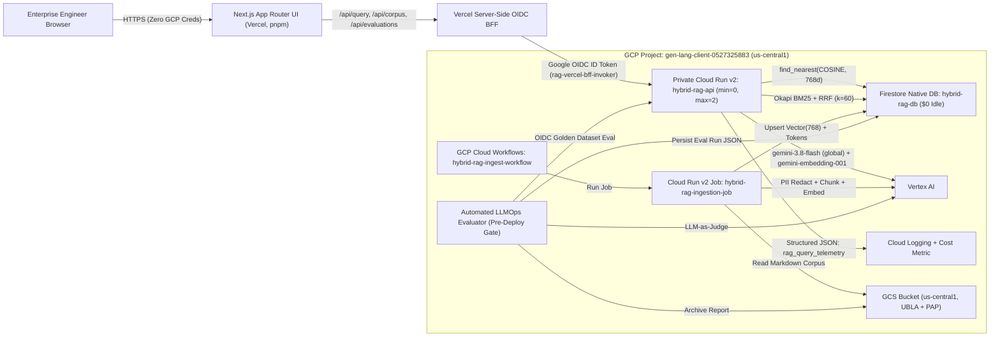

# Architecture — Enterprise Hybrid RAG & Automated LLMOps on GCP

## 1. High-Level System Architecture

## 2. Core Engineering Decisions

### 2.1 GCP Firestore Vector Search vs. Vertex AI Vector Search Endpoints
- **Decision**: Use a dedicated named Firestore Native database (`hybrid-rag-db` in `us-central1`) with a `FLAT` `COSINE` vector index (`dimension = 768`) on `rag_chunks.embedding`.
- **Rationale**: Vertex AI Vector Search Index Endpoints require always-on deployed nodes (~$75–$140/month per node even at zero traffic). Firestore Vector Search is 100% serverless with **$0.00 idle cost**, native IAM integration, and sub-100ms ANN/exact vector retrieval for enterprise corpora up to millions of chunks.
- **Matryoshka Dimensionality**: `gemini-embedding-001` is invoked with `output_dimensionality = 768`, staying well under Firestore's 2048-dimension index cap while reducing vector storage by 75%.

### 2.2 Hybrid Retrieval & Reciprocal Rank Fusion (RRF)
Pure dense vector search struggles with exact IAM role strings (`roles/run.invoker`), HTTP status codes (`401`/`403`), and numeric SLA tables. The RAG API executes:
1. **Dense Vector Search**: Firestore `find_nearest(vector_field="embedding", distance_measure=DistanceMeasure.COSINE, limit=candidate_limit)`.
2. **Sparse Lexical Retrieval**: Okapi BM25 (`k1 = 1.5`, `b = 0.75`) over pre-tokenized, stopword-filtered chunk terms.
3. **Weighted Reciprocal Rank Fusion**:
   $$\text{RRF}(d) = \frac{w_v}{k + r_v(d)} + \frac{w_l}{k + r_l(d)}$$
   with default `k = 60`, `w_v = 0.60`, `w_l = 0.40`. Users can also compare Hybrid vs. Vector-Only vs. BM25-Only live in the UI.

### 2.3 Zero-Trust Private Cloud Run IAM + Vercel OIDC BFF
- `hybrid-rag-api` grants `roles/run.invoker` **exclusively** to `rag-vercel-bff-invoker@<project>.iam.gserviceaccount.com`.
- Zero `allUsers` or `allAuthenticatedUsers` bindings exist. Direct unauthenticated requests return `HTTP 403 Forbidden` (or `401`).
- Vercel Next.js App Router API routes (`/api/*`) run on the Node.js server runtime, minting short-lived Google OIDC ID tokens via `google-auth-library` (`GoogleAuth.getIdTokenClient`) with `aud` set to the exact Cloud Run URL. Zero GCP credentials are ever shipped to the browser.

### 2.4 Automated LLMOps Evaluation & Pre-Deployment Quality Gate
Before promoting any prompt, chunking, or retrieval change, `services/evaluator` executes `data/golden_dataset.json` (14 cases covering factual, numeric SLA, multi-hop, and 3 out-of-scope negative probes) against the live API:
- **Hallucination Rate** (`<= 10%`): Combines deterministic inline `[doc_id#chunk]` citation verification, unanswerable abstention verification, and Vertex AI `gemini-3.8-flash` LLM-as-Judge grounding audit.
- **Context Precision@K** (`>= 75%`): Standard Average Precision@K over retrieved chunks.
- **Average Cost per Query** (`<= $0.005 USD`): Computed from exact Gemini token usage metadata and FinOps rate card (`$0.15/1M` input, `$0.60/1M` output, `$0.025/1M` embedding).
- **CI Gate Enforcement**: Exits with code `1` if any threshold fails; persists the signed JSON report to Firestore (`evaluation_runs`) and GCS (`evaluations/<run_id>.json`).

### 2.5 Zero Idle Cost Policy
Every Terraform resource enforces zero idle spend:
- Cloud Run v2 API: `min_instance_count = 0`, `max_instance_count = 2`, `cpu_idle = true`, `deletion_protection = false`.
- Cloud Run v2 Ingestion Job: On-demand batch execution only, `deletion_protection = false`.
- Firestore Native Vector Search + Cloud Workflows + GCS: 100% pay-per-use serverless ($0.00 idle).
